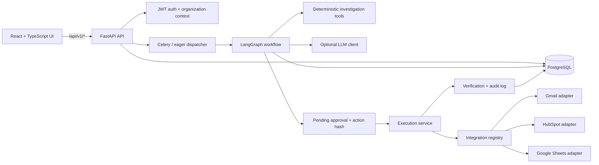

# RevenueOps Agent

AI-powered revenue operations execution platform.

Identify neglected opportunities. Investigate pipeline risks. Recommend actions. Execute with human approval.

Python · FastAPI · React · TypeScript · LangGraph · PostgreSQL · Redis · Celery

## 1. Problem

Revenue teams lose opportunities when high-value leads go stale, follow-ups are missed, and CRM data is incomplete. The work is spread across CRM records, email, spreadsheets, and activity logs, so a recommendation is only useful if it is evidence-backed and safely executable.

RevenueOps Agent turns that ambiguous workflow into a reliable, reviewable system: detect risk, gather context, propose an action, require approval, execute through an integration adapter, and verify the result.

## 2. What it does

- Detects neglected opportunities and pipeline data gaps.
- Investigates lead, CRM, spreadsheet, and activity context.
- Produces findings with evidence and priority.
- Drafts bounded action proposals: email follow-up, CRM task, or CRM update.
- Requires human approval before any external side effect.
- Executes through mock or live HubSpot, Gmail, and Google Sheets adapters.
- Records idempotency keys, execution status, verification results, and audit events.

## 3. Demo

- Live application: https://frontend-eight-kappa-mvu9los0gx.vercel.app/
- API documentation: https://revenueops-api-8iwn.onrender.com/docs
- API base URL: https://revenueops-api-8iwn.onrender.com/api/v1

Demo account:

- Email: `admin@example.com`
- Password: `password123`

The demo workspace contains seeded sample data only. Fresh local deployments create their own workspace during registration.

## 4. Architecture



The LLM is optional. The default deterministic path is used by tests and CI; live LLM output is sanitized, schema-validated, and falls back to deterministic behavior when invalid.

See `docs/architecture.md` for the component boundaries and `docs/workflow.md` for one action traced from detection to verification.

## 5. Core engineering decisions

- **Explicit workflow over one prompt:** LangGraph nodes make investigation, recommendation, persistence, and approval reviewable and testable.
- **Human approval for side effects:** Email sends, CRM writes, and spreadsheet changes require an authorized approver and a canonical action hash.
- **Idempotent execution:** Deterministic keys and provider-level references prevent duplicate side effects after retries or ambiguous timeouts.
- **Tenant isolation:** Authentication resolves organization membership, and service queries are scoped by `organization_id`.
- **Verification over assumption:** An execution is confirmed only when the adapter verifies an external reference; uncertain outcomes require reconciliation before replay.

Details are in `docs/engineering-decisions.md`.

## 6. Local setup

Requirements: Docker Desktop with Compose.

From the repository root:

```bash
docker compose up --build
```

Open the UI on port `5173` and the API documentation on port `8000/docs`. Register a workspace to seed demo integrations and sample leads.

Stop the stack:

```bash
docker compose down
```

For non-Docker setup, provider setup, and environment variables, see `docs/setup.md`.

## 7. Testing and evaluation

From `backend/`:

```bash
python -m pip install -r requirements-dev.txt
python -m ruff check .
python -m pytest -q
```

Verified result: `All checks passed!` and `30 passed, 1 skipped`. The skipped test is the opt-in live LLM evaluation.

From `frontend/`:

```bash
npm ci
npm run lint
npm run typecheck
npm run build
```

Verified result: lint, typecheck, and production build all pass.

Evaluation cases and scoring are documented in `docs/evaluation.md`.

## 8. Limitations

- Mock integrations are the default demo path.
- Live adapters and OAuth flows are implemented and covered with fake HTTP tests, but no real provider account or LLM credential was available for live verification.
- The production worker is defined but not deployed on the current Render free plan; queued executions need a running worker.
- This is a demonstration system, not a claim of full production readiness.

See `docs/limitations.md` for the complete list.

## Documentation

- `docs/architecture.md`: system boundaries and deployment shape
- `docs/workflow.md`: end-to-end action trace
- `docs/setup.md`: local and external integration setup
- `docs/engineering-decisions.md`: reliability and safety trade-offs
- `docs/evaluation.md`: evaluation cases and verified checks
- `docs/limitations.md`: current scope and unverified paths
