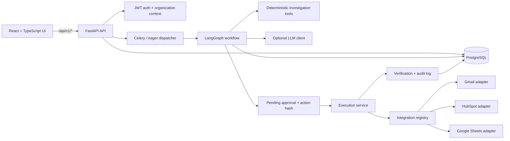

# Architecture

RevenueOps Agent is a tenant-scoped FastAPI service with a React frontend. It investigates revenue pipeline records, persists evidence-backed findings, proposes bounded actions, and requires human approval before any external side effect.

## Component boundaries

| Area | Responsibility | Key code |
| --- | --- | --- |
| API | Authentication, organizations, leads, tasks, approvals, executions, integrations, dashboard | `backend/app/api/v1/` |
| Workflow | Explicit investigation and recommendation state transitions | `backend/app/agent/graph.py`, `backend/app/agent/state.py` |
| LLM | Optional OpenAI-compatible JSON client with sanitization and fallback | `backend/app/agent/llm.py`, `backend/app/agent/sanitizer.py` |
| Business services | Tenant-scoped task, approval, execution, integration, and audit logic | `backend/app/services/` |
| Integrations | Mock and live Gmail, HubSpot, Google Sheets adapters; OAuth helpers; provider registry | `backend/app/integrations/` |
| Workers | Eager or Celery dispatch for agent runs and executions | `backend/app/workers/` |
| Persistence | SQLAlchemy models and Alembic migrations | `backend/app/models/entities.py`, `backend/alembic/versions/` |
| Frontend | Workflow UI for investigation, approvals, activity, and integrations | `frontend/src/` |

## Runtime paths

- `AGENT_MODE=deterministic`: rule-based classification, findings, and action drafting. This is the default and the CI path.
- `AGENT_MODE=llm`: optional LLM-assisted classification and action copy. Output is sanitized, schema-validated, and falls back deterministically when invalid.
- `INTEGRATION_MODE=mock`: seeded demo adapters; no external calls.
- `INTEGRATION_MODE=live`: OAuth, token exchange/refresh, and provider APIs are enabled when credentials are configured.
- `INTEGRATION_MODE=auto`: per-provider live behavior when complete credentials exist, otherwise mock.

## Persistence anchors

- `AgentTask` and `AgentTaskEvent` record workflow state and transition history.
- `Recommendation` stores evidence, priority, and the proposed action.
- `Approval` stores the action payload, approver decision, expiry, and canonical action hash.
- `ActionExecution` stores the unique idempotency key, provider reference, status, response, and error.
- `OAuthState` stores a hashed one-time state value bound to organization, user, provider, and redirect URI.
- `AuditEvent` records security-relevant transitions such as approval, execution, reconciliation, and retry.

## Safety boundaries

- Authentication resolves organization membership through `backend/app/core/deps.py`.
- Service queries are filtered by `organization_id`; cross-tenant approvals and executions are denied in tests.
- Action payloads are validated before approval, before execution, and during uncertain reconciliation.
- Approval edits cannot change provider, action type, target, lead, external ID, risk, or protected CRM fields.
- OAuth callback state is random, hashed at rest, expiring, single-use, and bound to the initiating user and redirect.
- External operations are verified after execution when the provider returns a reference.
- Uncertain executions are reconciled from stored references before replay and require explicit acknowledgement when unresolved.

## Deployment shape

The frontend is served by Vercel with a same-origin rewrite for `/api/*`. The API service runs `alembic upgrade head` before startup. PostgreSQL and Redis are managed services. A Celery worker definition exists for queued dispatch; the demo environment currently runs without that worker deployed, so queued paths are better demonstrated locally with eager execution or Docker Compose.
